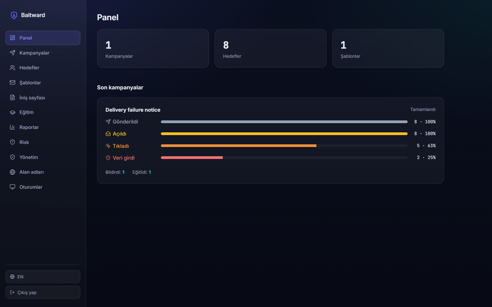
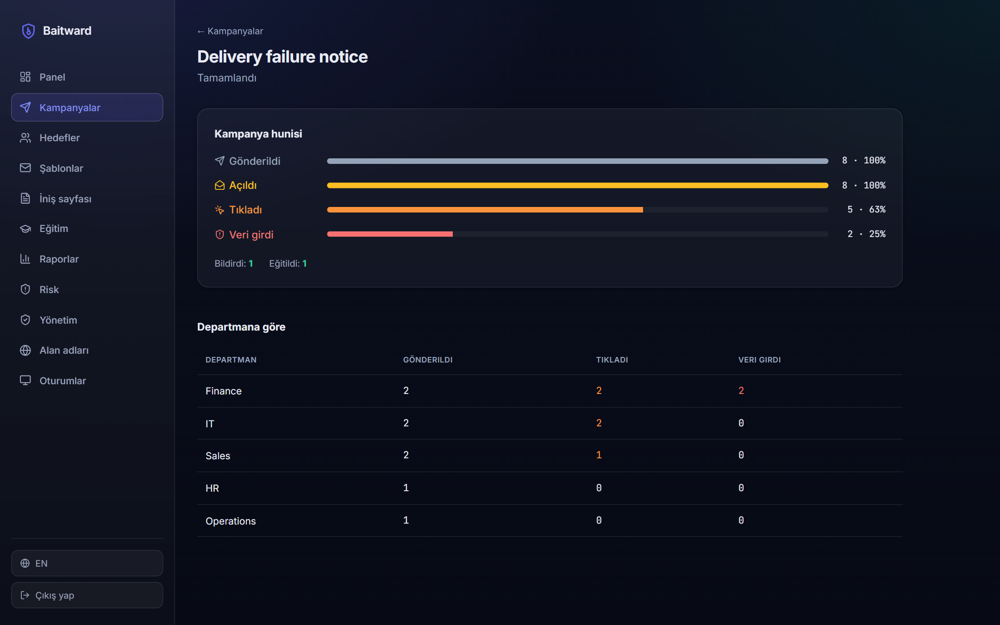
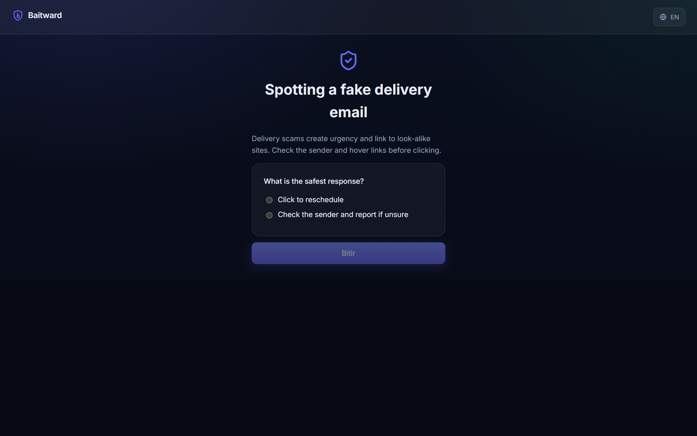
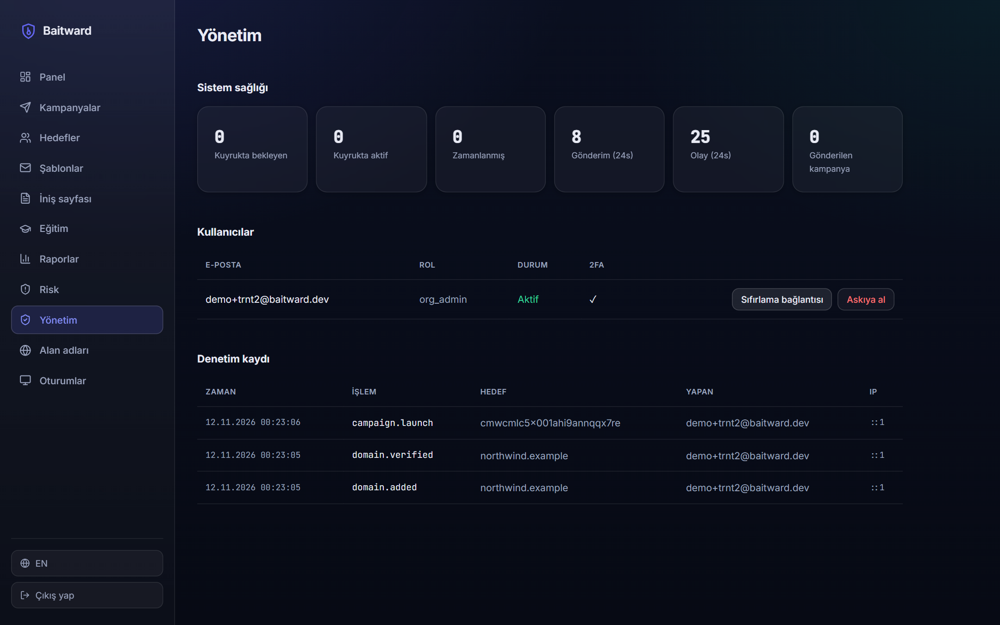
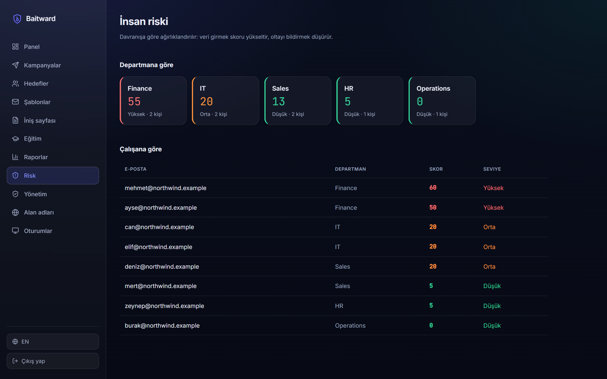

# Baitward

**Authorized phishing simulation and security awareness training for companies.**

Baitward lets a company test and train its **own** employees against phishing in a
safe, measurable and privacy-preserving way. An administrator builds a campaign from
a bilingual template; the platform sends controlled simulated emails at a drip rate,
measures who opens, clicks and submits, teaches the moment someone slips, and reports
to the organisation in an audit-ready form.

> **Live demo:** `<your-deployment-url>` — see [Deployment](#deployment).



## The idea

Most attacks begin with a phishing email. Organisations rarely know how resilient
their people actually are, while audits (ISO 27001, KVKK) ask for regular awareness
training and evidence of it. Baitward runs that test in a controlled environment and,
crucially, **teaches instead of punishing** — the most valued outcome is an employee
who spots the phish and reports it.

## What the platform guarantees

These rules hold for every campaign, on every channel:

- **Authorized use only.** A campaign can only launch once the organisation has a
  **verified domain** it owns. Unverified domains cannot send.
- **One tenant, one world.** Every query is filtered by the organisation id taken from
  the caller's access token — never from client input — so one organisation can never
  see or target another's data.
- **Every action is logged.** Admin operations and campaign launches are written to an
  append-only audit log with the actor, action, target, IP and time.
- **A teachable moment on every click.** Clicking leads to a landing page and then to
  short training with a quiz; completion is recorded.

## What is stored, and what is never stored

The most important design decision: **the content a target types into a fake form is
never stored.** The submit endpoint discards the request body and records only that a
`submitted` event happened, plus technical metadata.

| Table                                                    | What it holds                                                                          |
| -------------------------------------------------------- | -------------------------------------------------------------------------------------- |
| `organizations`                                          | name, plan, verified domain, monthly send limit, retention window                      |
| `users`                                                  | email, Argon2id password hash, role, encrypted TOTP secret, lock/suspend state         |
| `sessions`                                               | refresh-token **hash** only, ip, user agent, revoked/expiry                            |
| `targets`                                                | employee email, name, department, locale, groups                                       |
| `email_templates` / `landing_pages` / `training_modules` | reusable, localised content                                                            |
| `campaigns` / `campaign_targets`                         | schedule, drip rate, and a unique tracking token per recipient                         |
| `events`                                                 | `sent` / `opened` / `clicked` / `submitted` / `reported` / `trained` + ip + user agent |
| `audit_logs` / `domain_verifications` / `reports`        | governance and output                                                                  |

There is **no column anywhere for submitted credentials or form contents.** A tracking
URL carries only an opaque token — never a name or email.

## What it cannot tell you

Honest limits:

- **Opens are approximate.** The open pixel can be blocked or pre-fetched by a mail
  client, so "opened" undercounts (or occasionally overcounts). A click or submit is
  treated as implying an open, keeping the funnel monotonic.
- **The funnel is behavioural, not forensic.** It shows reach and reaction, not intent.
- **Risk is a heuristic.** The human-risk score is a weighted sum of behaviours, useful
  for comparison over time — not an absolute judgement of a person.

## The dashboard and the training page

The interface is a modern dark "glass" theme with a sidebar, built with hand-written
CSS and design tokens (no ready-made admin theme). Every screen has loading, empty,
error and filled states, and status is never shown by colour alone — an icon and a
bilingual label always travel with it.

|                                                                            |                                                                |
| -------------------------------------------------------------------------- | -------------------------------------------------------------- |
|  |  |
|           |               |

## Repository layout

```
api/
  src/auth/        sign-in, sessions, two-factor
  src/campaigns/   templates, targets, scheduling, drip launch
  src/tracking/    pixel, click and submit (no input stored)
  src/training/    training modules, quiz scoring, public training
  src/reports/     report data, bilingual HTML, PDF via a system browser
  src/risk/        weighted human-risk scoring
  src/admin/       users, system health, audit log
  src/domains/     domain-ownership verification
  prisma/          schema and migrations
worker/
  src/send/        (send-processor) drip email sending via Nodemailer
  src/schedule/    (schedule-processor) monthly awareness digest
web/
  src/pages/       the dashboard, editors, landing pages and training
  src/components/  sidebar shell, funnel, status badges
  src/i18n/        Turkish and English messages
docs/screenshots/  images used in this README
```

## Requirements

| Tool             | Version                      |
| ---------------- | ---------------------------- |
| Node.js          | ≥ 22                         |
| Docker + Compose | current                      |
| PostgreSQL       | 16 (via Docker)              |
| Redis            | 7 (via Docker)               |
| Chrome or Edge   | any recent (for PDF reports) |

## Running it locally

```bash
# 1. Install dependencies
npm install

# 2. Start Postgres, Redis and Mailpit
docker compose up -d

# 3. Set up the database
cp .env.example api/.env                      # PowerShell: Copy-Item .env.example api/.env
npm run prisma:migrate --workspace=api        # apply migrations
npm run prisma:generate --workspace=api       # generate the client

# 4. Create the first administrator (password is read hidden, never stored in the repo)
npm run admin:create --workspace=api

# 5. Run everything (api, worker and web in parallel)
npm run dev
```

- Web app: http://localhost:5180
- API: http://localhost:4000
- Mailpit (captured emails): http://localhost:8025

Sign in, verify a domain under **Domains** (use "Mark verified (dev)" locally), then
build a template, add targets, create a campaign and launch it. Watch the emails arrive
in Mailpit, click a link to see the landing page and training, and watch the dashboard
funnel update live.

## Deployment

The API and worker run together on one host (Docker); the web app builds to static
files (`npm run build --workspace=web`) served by any static host or CDN. Point the web
build at the API with `VITE_API_URL`, and set real secrets (`AUTH_ACCESS_SECRET`,
`TOTP_ENC_KEY`) plus SMTP credentials in production.

Verify a running deployment:

```bash
curl -s https://<your-deployment-url>/api/health
# {"status":"ok","service":"baitward-api","version":"0.1.0","time":"..."}
```

## Roadmap

| Stage | Work                                                                    |
| ----- | ----------------------------------------------------------------------- |
| Core  | Auth, campaigns, tracking, training, reporting, admin — **done**        |
| Next  | SMS / voice / QR channels, gamification, scheduled recurring campaigns  |
| Later | SSO (SAML/OIDC), SCIM provisioning, SIEM integration, benchmark reports |

## License

MIT — see [LICENSE](LICENSE).
